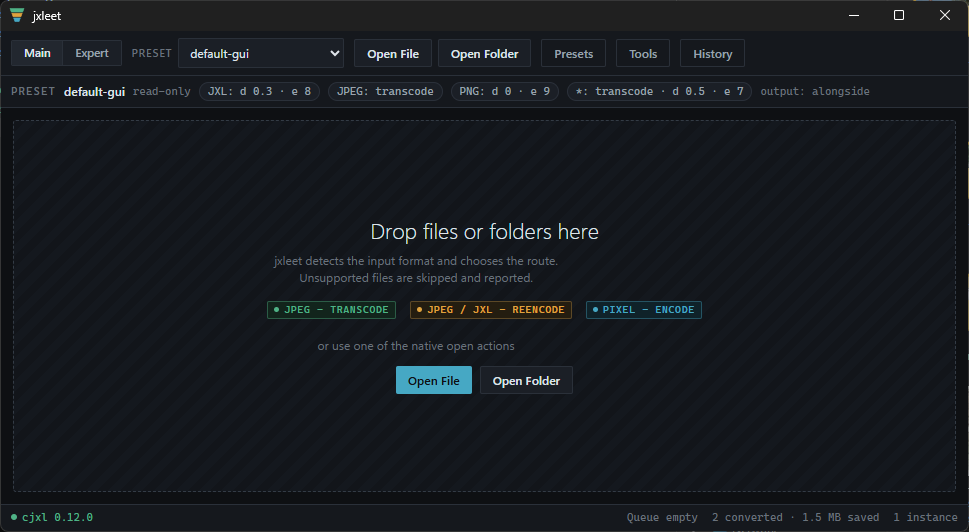

# jxlgui

**This repository is deleted.** jxlgui was only ever a proof of concept and is no longer maintained.

👉 The successor project is **[jxleet](https://github.com/dhcgn/jxleet/)**.

## About jxleet

JPEG-XL-Expert-Encoding-Tool — a comfortable way to use `cjxl` on Windows. It exposes the full `cjxl` flag surface through a GUI, an Explorer context menu, and the command line, with preset-based batch conversion, a managed libjxl toolchain, and Lightroom integration.

*Screenshot from a very early state of jxleet — the app has evolved since.*
